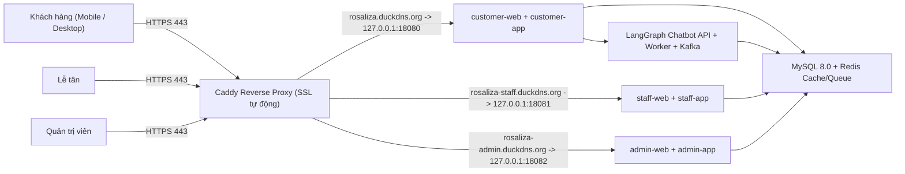

# Hướng Dẫn Deploy Toàn Bộ Dự Án Rosaliza Hotel Lên Internet (100% Miễn Phí)

Tài liệu này hướng dẫn chi tiết từng bước đưa toàn bộ hệ thống **Rosaliza Hotel** lên Internet cho người dùng thực tế sử dụng với chi phí **\$0/tháng**, giữ nguyên đầy đủ kiến trúc của dự án:
- **3 cổng giao diện tách biệt phiên đăng nhập:** Khách hàng (`Customer`), Lễ tân (`Staff`), Quản trị viên (`Admin`)
- **Cơ sở dữ liệu & bộ nhớ đệm:** MySQL 8 / MariaDB + 2 cụm Redis (`redis-cache`, `redis-queue`)
- **Sự kiện thời gian thực & Tác vụ nền:** Apache Kafka KRaft + Laravel Queue Worker + Laravel Scheduler (tự động hủy giữ chỗ quá 10 phút và tự hủy đơn chưa check-in lúc `18:00`)
- **Trợ lý ảo Pico AI (RAG + Live Tools):** LangGraph Node.js 20 kết nối Google Gemini API tốc độ cao (`gemini-3.1-flash-lite`)
- **Xác thực & Thanh toán:** Đăng nhập Google OAuth 2.0, gửi mã OTP qua Gmail SMTP, đặt cọc trực tuyến 50% qua VietQR.

---

## 1. Chọn Phương Án Deploy Miễn Phí Phù Hợp Nhất

Vì hệ thống chạy đầy đủ 14 dịch vụ Docker, các gói miễn phí chỉ có `512 MB RAM` (như Render Free đơn lẻ) sẽ bị tràn bộ nhớ nếu nhồi chung tất cả container. Dưới đây là **3 phương án thực tế 0 đồng** chạy mượt toàn bộ dự án:

| Tiêu chí | Phương án A: Oracle Cloud Always Free (Khuyên dùng số 1) | Phương án B: Cloudflare Tunnel từ máy đang chạy Docker | Phương án C: Hugging Face Spaces + TiDB + Upstash |
| :--- | :--- | :--- | :--- |
| **Chi phí** | **\$0 trọn đời** (Always Free) | **\$0 trọn đời** | **\$0/tháng** |
| **Cấu hình miễn phí** | `4 ARM OCPU`, **`24 GB RAM`**, `200 GB SSD` | Tận dụng RAM máy cá nhân / máy lab | `2 vCPU`, **`16 GB RAM`** + `5 GB` MySQL + Redis |
| **Cần thẻ Visa/Mastercard xác minh?** | Có (chỉ xác minh danh tính, không trừ tiền; sinh viên có thể thay bằng gói GitHub Student Pack \$200 DigitalOcean / \$100 Azure) | **Không cần thẻ** | **Không cần thẻ** |
| **Chạy 24/7 khi tắt laptop?** | **Có (chạy 24/7 độc lập)** | Không (máy bật thì web chạy) | **Có (kèm UptimeRobot giữ thức)** |
| **Hỗ trợ đủ 3 cổng + Kafka + Chatbot?** | **100% nguyên bản (`compose.yaml`)** | **100% nguyên bản (`compose.local-infra.yaml`)** | Chạy tốt Web + Chatbot + MySQL + Redis |
| **Thời gian thiết lập** | ~25 đến 35 phút | **~5 phút** | ~20 phút |

> [!TIP]
> - Nếu muốn **website hoạt động ổn định 24/7 như sản phẩm thương mại thực thụ**, hãy chọn **Phương án A**.
> - Nếu cần **đưa web lên mạng ngay lập tức để demo, bảo vệ đồ án hoặc gửi link cho bạn bè/giảng viên dùng thử trên điện thoại**, hãy chọn **Phương án B**.
> - Nếu **chưa có thẻ thanh toán quốc tế** nhưng vẫn muốn treo máy chủ Cloud 24/7, hãy chọn **Phương án C**.

---

## 2. Chuẩn Bị Các Dịch Vụ Phụ Trợ Miễn Phí 100% (Dùng Chung)

Trước khi bắt đầu bất kỳ phương án nào, hãy chuẩn bị sẵn 4 thông tin miễn phí sau:

### 2.1. Khóa Google Gemini API Miễn Phí (Cho Chatbot Pico AI)
1. Truy cập https://aistudio.google.com/apikey và đăng nhập bằng tài khoản Gmail.
2. Nhấn **Create API key**, sao chép chuỗi khóa bắt đầu bằng `AIza...` để điền vào biến `GOOGLE_API_KEY`.
3. Gói miễn phí của Google AI Studio hỗ trợ sẵn mô hình `gemini-3.1-flash-lite` và `gemini-embedding-001` với tốc độ phản hồi rất nhanh, không tốn phí.

### 2.2. Mật Khẩu Ứng Dụng Gmail SMTP Miễn Phí (Gửi OTP & Email Xác Nhận Đặt Phòng)
1. Truy cập quản lý tài khoản Google tại https://myaccount.google.com/security.
2. Bật **Xác minh 2 bước (2-Step Verification)**.
3. Truy cập https://myaccount.google.com/apppasswords, đặt tên ứng dụng là `Rosaliza Hotel` và nhấn **Tạo**.
4. Sao chép **16 ký tự mật khẩu ứng dụng** (bỏ khoảng trắng) để điền vào `MAIL_PASSWORD` (hạn mức miễn phí: `500` email/ngày).

### 2.3. Cấu Hình Google Cloud OAuth 2.0 (Cho Khách Hàng Đăng Nhập Google)
1. Truy cập https://console.cloud.google.com/apis/credentials.
2. Tại mục **OAuth consent screen**:
   - Đổi trạng thái **Publishing status** từ *Testing* sang **In production (Publish App)**.
   - Bước này rất quan trọng: nếu để ở chế độ *Testing*, chỉ các email nằm trong danh sách *Test users* mới đăng nhập được; khi chuyển sang **In production**, mọi khách hàng dùng Gmail thật đều có thể đăng nhập/đăng ký ngay.
3. Tại mục **Credentials** -> chọn **OAuth 2.0 Client ID** (loại *Web application*):
   - **Authorized JavaScript origins**: thêm địa chỉ HTTPS cổng khách hàng (ví dụ `https://rosaliza.duckdns.org`).
   - **Authorized redirect URIs**: thêm chính xác `https://rosaliza.duckdns.org/auth/google/callback`.
4. Lưu lại `GOOGLE_CLIENT_ID` và `GOOGLE_CLIENT_SECRET`.

### 2.4. Cấu Hình Đặt Cọc Online VietQR / Cổng Thanh Toán Thử Nghiệm
- **VietQR + SePay (Miễn phí cho cá nhân/đồ án):** Điền `VIETQR_BANK_BIN`, `VIETQR_ACCOUNT_NO`, `VIETQR_ACCOUNT_NAME` để hệ thống sinh mã QR chuyển khoản chuẩn Napas 247 đúng số tiền cọc 50% và nội dung đơn đặt phòng. Có thể đăng ký tài khoản miễn phí tại https://sepay.vn để nhận webhook tự động xác nhận giao dịch (`SEPAY_TOKEN`).
- **VNPay / MoMo / ZaloPay Sandbox (Miễn phí 100%):** Đăng ký tài khoản môi trường thử nghiệm (Sandbox) tại https://sandbox.vnpayment.vn/devreg/ để lấy `VNPAY_TMN_CODE` và `VNPAY_HASH_SECRET` cho khách hàng trải nghiệm thanh toán thẻ nội địa ảo không mất tiền thật.

---

## 3. Phương Án A (Khuyên Dùng): Deploy 24/7 Trên Oracle Cloud Always Free + DuckDNS + Caddy HTTPS

### Kiến trúc triển khai Phương án A



### Bước A.1: Khởi tạo máy chủ miễn phí vĩnh viễn và mở cổng mạng
1. Đăng ký tài khoản **Oracle Cloud Free Tier** tại https://www.oracle.com/cloud/free/ (hoặc nếu là sinh viên có email `.edu.vn`, nhận gói **GitHub Student Developer Pack** tại https://education.github.com/pack để lấy \$200 tín dụng DigitalOcean hoặc \$100 Microsoft Azure).
2. Trên Oracle Cloud, vào **Compute -> Instances -> Create Instance**:
   - **Image**: `Ubuntu 24.04 Minimal` hoặc `Ubuntu 24.04 LTS (aarch64)`
   - **Shape**: Chọn dòng **Ampere (ARM)** `VM.Standard.A1.Flex`, kéo thanh cấu hình lên **`4 OCPU`** và **`24 GB RAM`** (nằm trọn trong hạn mức *Always Free*, \$0/tháng vĩnh viễn).
   - **Boot Volume**: Đặt `100 GB` (miễn phí tối đa tới `200 GB`).
   - Tải khóa SSH (`ssh-key.key`) về máy và lưu lại địa chỉ **Public IP** của máy chủ (ví dụ `152.xx.xx.xx`).
3. Mở cổng `80` và `443` trên **Security List (Ingress Rules)** của Oracle Cloud:
   - Source CIDR: `0.0.0.0/0`, IP Protocol: `TCP`, Destination Port Range: `80` và `443`.
   - **Tuyệt đối không mở** các cổng `3306`, `6379`, `9092`, `2024`, `18080`, `18081`, `18082` ra ngoài Internet.

### Bước A.2: Tạo 3 tên miền miễn phí trên DuckDNS
1. Truy cập https://www.duckdns.org và đăng nhập nhanh bằng tài khoản Google hoặc GitHub.
2. Tạo 3 tên miền phụ miễn phí và trỏ cả 3 về cùng địa chỉ **Public IP** của máy chủ ở Bước A.1:
   - `rosaliza.duckdns.org` (Cổng Khách hàng)
   - `rosaliza-staff.duckdns.org` (Cổng Lễ tân)
   - `rosaliza-admin.duckdns.org` (Cổng Quản trị viên)

*(Nếu bạn có tên miền riêng miễn phí hoặc giá rẻ quản lý trên Cloudflare DNS, bạn chỉ cần tạo 3 bản ghi `A` là `@`, `staff`, `admin` trỏ về cùng Public IP của máy chủ).*

### Bước A.3: Kết nối SSH và cài đặt Docker + Caddy trên máy chủ Ubuntu
Mở PowerShell hoặc Terminal trên máy cá nhân, kết nối vào máy chủ:

```bash
ssh -i duong_dan_toi_ssh_key.key ubuntu@IP_MAY_CHU
```

Chạy cụm lệnh cài đặt Docker Engine, Docker Compose, Git, tường lửa và tạo thêm `4 GB Swap` dự phòng:

```bash
sudo apt-get update && sudo apt-get upgrade -y
sudo apt-get install -y ca-certificates curl gnupg git ufw debian-keyring debian-archive-keyring apt-transport-https

# Tạo 4GB Swap giúp build Docker mượt mà không bao giờ thiếu bộ nhớ
sudo fallocate -l 4G /swapfile
sudo chmod 600 /swapfile
sudo mkswap /swapfile
sudo swapon /swapfile
echo '/swapfile none swap sw 0 0' | sudo tee -a /etc/fstab

# Cài đặt Docker chính thức
curl -fsSL https://get.docker.com | sudo sh
sudo usermod -aG docker $USER

# Cài đặt Caddy Web Server (tự động cấp chứng chỉ HTTPS miễn phí)
curl -1sLf 'https://dl.cloudsmith.io/public/caddy/stable/gpg.key' | sudo gpg --dearmor -o /usr/share/keyrings/caddy-stable-archive-keyring.gpg
curl -1sLf 'https://dl.cloudsmith.io/public/caddy/stable/debian.deb.txt' | sudo tee /etc/apt/sources.list.d/caddy-stable.list
sudo apt-get update && sudo apt-get install -y caddy

# Mở cổng SSH, HTTP, HTTPS trên tường lửa Ubuntu
sudo ufw allow OpenSSH
sudo ufw allow 80/tcp
sudo ufw allow 443/tcp
sudo ufw --force enable
```

Đăng xuất và đăng nhập lại SSH một lần (`exit` rồi `ssh ...`) để nhận quyền nhóm `docker`.

### Bước A.4: Tải mã nguồn và cấu hình tệp `.env` chuẩn Production
Clone mã nguồn từ GitHub lên máy chủ:

```bash
sudo mkdir -p /opt/rosaliza
sudo chown $USER:$USER /opt/rosaliza
cd /opt/rosaliza
git clone -b Update-Responsive-Docker https://github.com/VanQuang070805/qlkhachsan.git .
```

Sinh sẵn các khóa bảo mật ngẫu nhiên bằng OpenSSL và tạo tệp `.env`:

```bash
APP_SECRET="base64:$(openssl rand -base64 32)"
DB_PASS="$(openssl rand -hex 16)"
DB_ROOT_PASS="$(openssl rand -hex 20)"
LG_INTERNAL_KEY="$(openssl rand -hex 24)"
LG_TOOL_KEY="$(openssl rand -hex 24)"

cat > .env <<EOF
APP_NAME="Rosaliza Hotel"
APP_ENV=production
APP_DEBUG=false
APP_KEY=${APP_SECRET}
APP_TIMEZONE=Asia/Ho_Chi_Minh

# 3 cổng tên miền HTTPS tách biệt
CUSTOMER_PORTAL_URL=https://rosaliza.duckdns.org
STAFF_PORTAL_URL=https://rosaliza-staff.duckdns.org
ADMIN_PORTAL_URL=https://rosaliza-admin.duckdns.org

# Chỉ lắng nghe nội bộ trên loopback để chỉ Caddy mới gọi vào được
CUSTOMER_PORT=127.0.0.1:18080
STAFF_PORT=127.0.0.1:18081
ADMIN_PORT=127.0.0.1:18082

# Cookie bảo mật HTTPS & Proxy
SESSION_SECURE_COOKIE=true
SESSION_SAME_SITE=lax
TRUSTED_PROXIES=*

# Cơ sở dữ liệu MySQL (tự nạp snapshot + chạy migration ở lần đầu)
DB_BOOTSTRAP_MODE=snapshot
DB_DATABASE=qlkhachsan
DB_USERNAME=royal_app
DB_PASSWORD=${DB_PASS}
MYSQL_ROOT_PASSWORD=${DB_ROOT_PASS}

# Khóa nội bộ bảo vệ giao tiếp giữa Laravel và LangGraph Chatbot
LANGGRAPH_INTERNAL_API_KEY=${LG_INTERNAL_KEY}
LANGGRAPH_TOOL_API_KEY=${LG_TOOL_KEY}

# Điền thông tin thực tế đã chuẩn bị ở Mục 2:
GOOGLE_API_KEY=DIEN_GOOGLE_GEMINI_API_KEY_CUA_BAN
GEMINI_CHAT_MODEL=gemini-3.1-flash-lite
GEMINI_EMBEDDING_MODEL=gemini-embedding-001

GOOGLE_CLIENT_ID=DIEN_GOOGLE_CLIENT_ID_CUA_BAN
GOOGLE_CLIENT_SECRET=DIEN_GOOGLE_CLIENT_SECRET_CUA_BAN
GOOGLE_REDIRECT_URI=https://rosaliza.duckdns.org/auth/google/callback

MAIL_MAILER=smtp
MAIL_HOST=smtp.gmail.com
MAIL_PORT=587
MAIL_ENCRYPTION=tls
MAIL_USERNAME=DIEN_GMAIL_CUA_BAN@gmail.com
MAIL_PASSWORD=DIEN_MAT_KHAU_UNG_DUNG_16_KY_TU
MAIL_FROM_ADDRESS=DIEN_GMAIL_CUA_BAN@gmail.com
MAIL_FROM_NAME="Rosaliza Hotel"

VIETQR_BANK_BIN=970422
VIETQR_ACCOUNT_NO=DIEN_SO_TAI_KHOAN_NHAN_COC
VIETQR_ACCOUNT_NAME="ROSALIZA HOTEL"
EOF

chmod 600 .env
```

Mở `nano .env` để thay các dòng `DIEN_...` bằng khóa thật của bạn, sau đó bấm `Ctrl+O` -> `Enter` -> `Ctrl+X` để lưu.

### Bước A.5: Dựng và khởi chạy toàn bộ 14 container Docker
Chạy lệnh khởi tạo toàn bộ hệ thống từ tệp `compose.yaml`:

```bash
docker compose -f compose.yaml up -d --build
```

Theo dõi tiến trình tự động nạp cơ sở dữ liệu (`app-init`), tạo topic Kafka (`kafka-init`) và đồng bộ kho tri thức vector cho Pico AI (`chatbot-init`):

```bash
docker compose -f compose.yaml ps
docker compose -f compose.yaml logs -f app-init chatbot-init chatbot-api
```

Khi thấy `customer-web`, `staff-web`, `admin-web`, `chatbot-api`, `laravel-worker` và `scheduler` đều ở trạng thái `Up`, hệ thống backend đã sẵn sàng.

### Bước A.6: Cấu hình Caddy cấp HTTPS miễn phí và chống trễ luồng SSE Chatbot
Chỉnh sửa tệp `/etc/caddy/Caddyfile`:

```bash
sudo tee /etc/caddy/Caddyfile > /dev/null <<'EOF'
rosaliza.duckdns.org {
    encode zstd gzip

    # Tắt gom bộ đệm (buffering) riêng cho đường truyền SSE của Chatbot để chữ hiện tức thì
    @chatbot_sse path /chatbot/stream /api/v1/customer/chat/runs/*/events
    reverse_proxy @chatbot_sse 127.0.0.1:18080 {
        flush_interval -1
    }

    reverse_proxy 127.0.0.1:18080
}

rosaliza-staff.duckdns.org {
    encode zstd gzip
    reverse_proxy 127.0.0.1:18081
}

rosaliza-admin.duckdns.org {
    encode zstd gzip
    reverse_proxy 127.0.0.1:18082
}
EOF

sudo systemctl reload caddy
```

Chỉ sau khoảng `10 - 20 giây`, Caddy sẽ tự động xin chứng chỉ SSL miễn phí từ Let's Encrypt và kích hoạt HTTPS xanh cho cả 3 cổng:
- Khách hàng: `https://rosaliza.duckdns.org`
- Lễ tân: `https://rosaliza-staff.duckdns.org`
- Quản trị: `https://rosaliza-admin.duckdns.org`

> [!IMPORTANT]
> Ngay sau khi lên sóng lần đầu, hãy đăng nhập cổng Quản trị (`https://rosaliza-admin.duckdns.org/admin/login`) và **đổi ngay mật khẩu mặc định** của tài khoản `admin` và `staff` để đảm bảo an toàn tuyệt đối.

---

## 4. Phương Án B (Nhanh Nhất 5 Phút, Không Cần Thẻ): Xuất Bản Cụm Docker Đang Chạy Bằng Cloudflare Tunnel

Nếu máy tính cá nhân hoặc máy trạm của nhóm đang chạy sẵn cụm Docker (`compose.local-infra.yaml` ở các cổng `:10800`, `:10801`, `:10802`), bạn có thể đưa toàn bộ 3 cổng lên Internet kèm HTTPS chuẩn hoàn toàn miễn phí trong **5 phút**, không cần mua VPS và không cần mở port modem Wi-Fi.

### Cách B.1: Dùng nhanh không cần mua tên miền (Quick Tunnel `*.trycloudflare.com`)
1. Cài đặt công cụ `cloudflared` miễn phí trên Windows bằng PowerShell:
   ```powershell
   winget install --id Cloudflare.cloudflared -e
   ```
2. Đảm bảo cụm Docker của dự án đang chạy (`ops\start-local.ps1` hoặc `docker compose -f compose.local-infra.yaml up -d`).
3. Mở 3 cửa sổ PowerShell chạy 3 đường hầm cho 3 giao diện:
   ```powershell
   # Cửa sổ 1 - Cổng Khách hàng (:10800)
   cloudflared tunnel --url http://127.0.0.1:10800

   # Cửa sổ 2 - Cổng Lễ tân (:10801)
   cloudflared tunnel --url http://127.0.0.1:10801

   # Cửa sổ 3 - Cổng Quản trị (:10802)
   cloudflared tunnel --url http://127.0.0.1:10802
   ```
4. Cloudflare sẽ trả về ngay 3 đường dẫn `https://ten-ngau-nhien.trycloudflare.com`.
5. Nếu muốn thử tính năng **Đăng nhập bằng Google** trên đường dẫn này:
   - Thêm `https://ten-ngau-nhien.trycloudflare.com/auth/google/callback` vào **Authorized redirect URIs** trên Google Cloud Console.
   - Cập nhật `APP_URL`, `CUSTOMER_PORTAL_URL`, `GOOGLE_REDIRECT_URI` và `TRUSTED_PROXIES=*` trong `.env`, sau đó chạy:
     ```powershell
     docker compose -f compose.local-infra.yaml up -d --force-recreate customer-portal staff-portal admin-portal
     ```

### Cách B.2: Dùng tên miền cố định miễn phí với Cloudflare Zero Trust
Nếu bạn đăng ký tên miền sinh viên miễn phí (ví dụ chương trình **Namecheap / Name.com miễn phí 1 năm trong GitHub Student Pack**, hoặc `eu.org`) và thêm vào tài khoản Cloudflare miễn phí:
1. Mở https://one.dash.cloudflare.com -> **Networks -> Tunnels -> Create a tunnel** -> chọn **Cloudflared**, đặt tên `rosaliza-hotel`.
2. Chạy lệnh cài đặt connector `cloudflared.exe service install <TOKEN>` hiển thị trên màn hình.
3. Tại tab **Public Hostname**, thêm 3 bản ghi ánh xạ thẳng vào Docker trên máy của bạn:
   - `rosaliza.tenmiencuaban.me` -> Service: `HTTP`, URL: `127.0.0.1:10800`
   - `staff.tenmiencuaban.me` -> Service: `HTTP`, URL: `127.0.0.1:10801`
   - `admin.tenmiencuaban.me` -> Service: `HTTP`, URL: `127.0.0.1:10802`
4. Tên miền sẽ giữ cố định vĩnh viễn, tự động có HTTPS và chống DDoS miễn phí từ Cloudflare.

---

## 5. Phương Án C (Cloud 24/7 Không Cần Thẻ Tín Dụng): Hugging Face Spaces (16 GB RAM) + TiDB Cloud + Upstash

Nếu bạn **không có thẻ Visa/Mastercard** để xác minh Oracle Cloud nhưng vẫn muốn chạy trên máy chủ đám mây 24/7 (tắt laptop web vẫn hoạt động):

1. **Tạo Database MySQL miễn phí (`5 GB`) trên TiDB Cloud Serverless (không cần thẻ):**
   - Đăng ký bằng GitHub/Google tại https://tidbcloud.com -> tạo cụm **Serverless** khu vực *Singapore*.
   - Lấy thông tin `DB_HOST`, `DB_PORT=4000`, `DB_USERNAME`, `DB_PASSWORD`, `DB_DATABASE` (bật `MYSQL_ATTR_SSL_CA=/etc/ssl/certs/ca-certificates.crt` cho kết nối TLS).
2. **Tạo Redis miễn phí trên Upstash (không cần thẻ):**
   - Đăng ký tại https://upstash.com -> tạo 1 database Redis khu vực *Singapore* -> lấy `REDIS_HOST`, `REDIS_PORT`, `REDIS_PASSWORD`.
3. **Triển khai Web + Chatbot lên Hugging Face Spaces (Docker SDK, miễn phí `2 vCPU` và `16 GB RAM`):**
   - Truy cập https://huggingface.co/new-space -> chọn **Docker (Blank)**, chế độ **Public** (miễn phí `16 GB RAM`).
   - Trong phần **Settings -> Variables and secrets**, khai báo các biến môi trường giống tệp `.env` ở Bước A.4 (trỏ `DB_HOST` sang TiDB Cloud và `REDIS_HOST` sang Upstash).
   - Vì mỗi Hugging Face Space mở cổng `7860`, bạn có thể tạo 1 Space chính cho cổng Khách hàng (`PORTAL_CONTEXT=customer`) và nếu cần tách cổng nội bộ, tạo thêm Space thứ hai cho `staff`/`admin` dùng chung chính cơ sở dữ liệu TiDB và Redis ở trên.
4. **Giữ Space hoạt động 24/7 không ngủ đông:**
   - Đăng ký tài khoản miễn phí tại https://uptimerobot.com -> tạo bộ theo dõi HTTP(s) trỏ vào đường dẫn `/up` của Space mỗi `5 phút`.

---

## 6. Quy Trình Cập Nhật Code Mới Lên Server Không Mất Dữ Liệu

Khi nhóm cập nhật tính năng mới lên nhánh GitHub, chỉ cần SSH vào máy chủ (Phương án A) và chạy 4 dòng lệnh sau (dữ liệu đặt phòng và tài khoản trong `mysql_data` được giữ nguyên an toàn 100%):

```bash
cd /opt/rosaliza
git pull origin Update-Responsive-Docker
docker compose -f compose.yaml up -d --build
docker compose -f compose.yaml run --rm app-init
```

---

## 7. Bảng Xử Lý Nhanh Các Sự Cố Thường Gặp Khi Deploy

| Hiện tượng gặp phải | Nguyên nhân gốc | Cách khắc phục ngay |
| :--- | :--- | :--- |
| Trình duyệt báo `ERR_TOO_MANY_REDIRECTS` khi bật HTTPS | Laravel chưa tin cậy header `X-Forwarded-Proto: https` từ proxy đứng trước | Đặt `TRUSTED_PROXIES=*` trong `.env` rồi chạy `docker compose -f compose.yaml up -d --force-recreate customer-app staff-app admin-app` |
| Đăng nhập Google báo `Lỗi 400: redirect_uri_mismatch` | URI trên Google Cloud chưa trùng khớp giao thức `https://` hoặc tên miền | Kiểm tra `GOOGLE_REDIRECT_URI=https://<ten-mien-customer>/auth/google/callback` khớp từng ký tự với mục **Authorized redirect URIs** trên Google Cloud Console |
| Khách hàng lạ đăng nhập Google báo `403: access_denied` | Ứng dụng Google OAuth đang để ở trạng thái **Testing** | Vào **Google Cloud Console -> OAuth consent screen -> Publish App** để chuyển sang **In production** |
| Chatbot trả lời chậm hoặc đợi xong cả đoạn mới hiện một lần | Reverse proxy gom gói tin (buffering) làm nghẽn luồng SSE `/chatbot/stream` | Giữ cấu hình `flush_interval -1` trong `Caddyfile` (hoặc `proxy_buffering off;` nếu dùng Nginx ngoài) |
| Không nhận được mã OTP qua Gmail khi đăng ký tài khoản | Dùng mật khẩu đăng nhập Gmail thường thay vì Mật khẩu ứng dụng 16 ký tự | Tạo **App Password** 16 ký tự tại https://myaccount.google.com/apppasswords, điền vào `MAIL_PASSWORD`, và đảm bảo `laravel-worker` đang chạy (`Up`) |
| Mở camera quét mã QR trên cổng Lễ tân bị trình duyệt chặn | Trình duyệt chỉ cho phép gọi `getUserMedia` (Camera) trên kết nối `HTTPS` (hoặc `localhost`) | Luôn truy cập cổng Lễ tân qua địa chỉ `https://` do Caddy hoặc Cloudflare Tunnel cấp |
